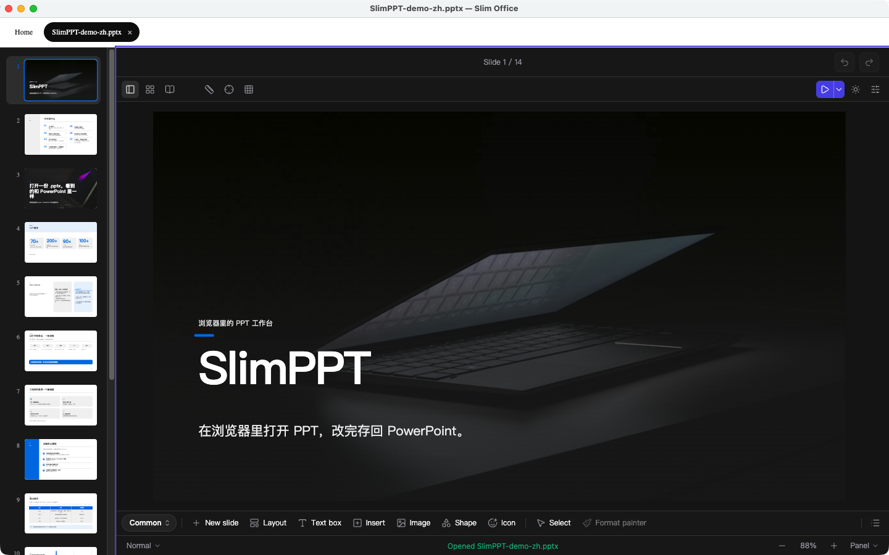
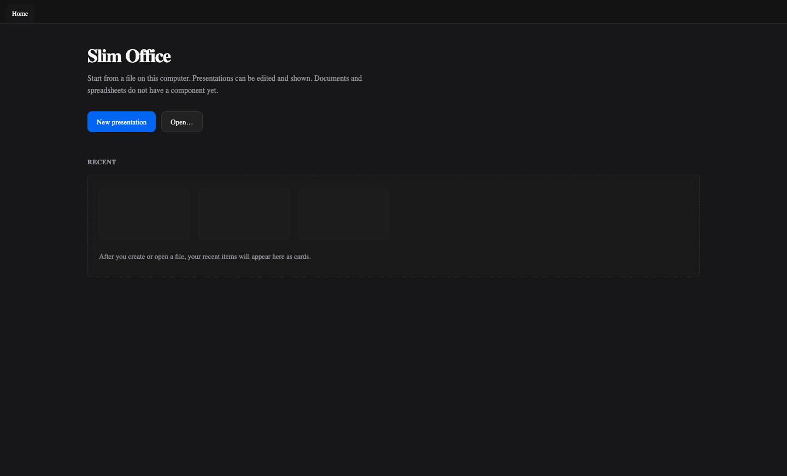

# Slim Office

Open a `.pptx` you already have. Edit and present it in the browser, then write the file back.

Documents and spreadsheets are planned. This repository ships the presentation part.

**[Editor](https://edit.slimppt.com)** · **[Docs](https://docs.slimppt.com/guide/getting-started)** · **[Open source](https://docs.slimppt.com/guide/open-source)**

English · [中文](./README.zh-CN.md)

 

## Is this for you?

- **Present** a deck in your own page.
- **Edit** the file, or export a video.
- **Let an agent** change `.pptx` files in one folder. Saving writes the file.

If the [editor](https://edit.slimppt.com) is enough, you do not need these packages. Accounts, online sharing, online storage, live broadcast, collaboration, and the hosted model stay there.

## Start here

How to install, read a file, present it, and write it back is in the [open-source guide](https://docs.slimppt.com/guide/open-source). That page lists each package and the other entries.

## On this computer

The desktop app is in `desktop/`. It opens files on this computer. The file home lists recent files; a presentation opens in the editor.

## Generate

Name Ink Board or Folio and that look holds for the whole generation: porcelain paper and near-black ink, or cool white with International Klein Blue. Calling a model with your own key is in the [open-source guide](https://docs.slimppt.com/guide/open-source).

## License

License: [AGPL-3.0-or-later](LICENSE). Copyright holder: Sliiu Inc, see [COPYRIGHT](COPYRIGHT). A closed-source embed requires a commercial license. See [COMMERCIAL.md](COMMERCIAL.md).
