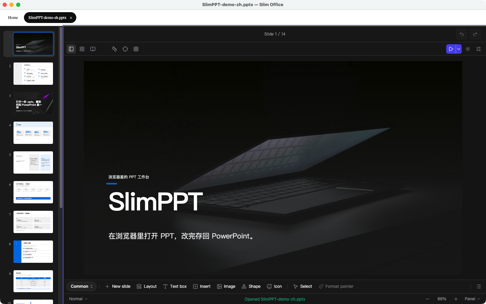
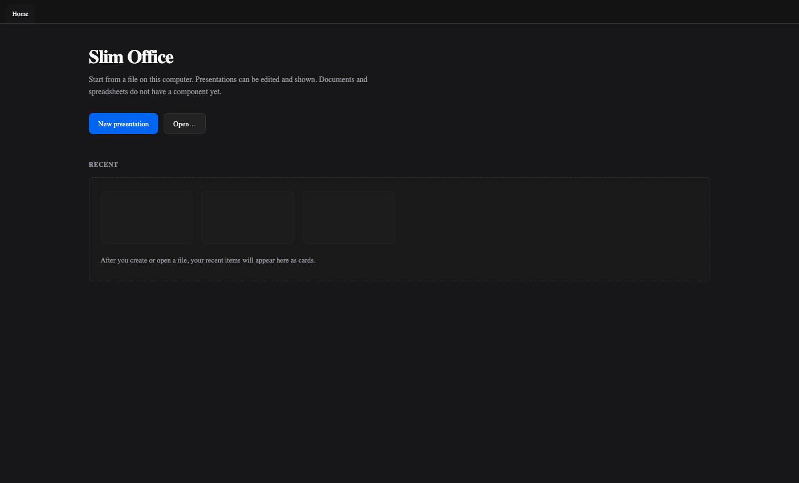

<div align="center">

# Slim Office

打开已有的 `.pptx`，在浏览器里改、放映，再写回文件。

文档和表格正在计划中。这个仓库现在只有演示部分。

**[编辑器](https://edit.slimppt.com)** · **[文档](https://docs.slimppt.com/zh-cn/guide/getting-started)** · **[开源说明](https://docs.slimppt.com/zh-cn/guide/open-source)**

[English](./README.md) · 中文

<br>



</div>

## 这是不是给你用的

这些包打开 `.pptx`，改它，放映它，再写出 `.pptx`、HTML、PDF、PNG 或视频。

- **放映**：把一份文稿放进你自己的页面。
- **编辑**：改这个文件，或导出视频。
- **交给 Agent**：改一个文件夹里的 `.pptx`。保存会写回这个文件。

只用[编辑器](https://edit.slimppt.com)就够时，不必装这些包。账号、在线分享、在线存储、直播放映、协作和系统模型仍在编辑器里。

## 三步开始

**1 · 安装**读、放映、写这三件要用的包。

```sh
npm install @sliiu/present-parser @sliiu/present-player @sliiu/present-serializer
```

已经有解析好的文稿时，只装 `@sliiu/present-player`。`@sliiu/present-editor` 加上编辑界面和视频导出。

**2 · 读并放映。3 · 写回去。**

```ts
import { parsePptx } from "@sliiu/present-parser";
import { writePptx } from "@sliiu/present-serializer";
import { mount } from "@sliiu/present-player";

const pres = await parsePptx(await file.arrayBuffer());
mount(stage, pres);
const pptx = writePptx(pres);
```

每个入口都带类型、ESM 和 CJS。

## 能做什么

### 放映

`mount` 接收的是已经解析好的演示文稿，不是 `.pptx` 文件本身。放进页面时，用普通 script 引入 `dist/player.iife.js`，全局名是 `PPTPlayer`。

```html
<script src="node_modules/@sliiu/present-player/dist/player.iife.js"></script>
<script>
  PPTPlayer.mount(document.querySelector("#stage"), presentation);
</script>
```

HTML、PDF 和 PNG 也从这个包导出。插件单文件是 `dist/plugin-sdk.iife.js`，全局名 `PPTPluginSDK`。放映脚本里已经有 `PPTPlayer.definePlugin`。

### 编辑

```ts
import { mountEditor } from "@sliiu/present-editor";

mountEditor(editor, pres);
```

editor 会带上视频导出（ffmpeg.wasm）、文字识别、OpenCV 和公式渲染。

桌面应用在 `desktop/`。它打开这台电脑上的文件。文件首页列出最近文件；演示文稿会进入编辑器。



### 生成

`@sliiu/present-ai` 用你自己的密钥调用模型。点名 Ink Board 或 Folio，整次生成都会停在这一套：瓷纸配近黑墨，或冷白纸加一笔国际克莱因蓝。

### 本地文稿

Agent 用和在线文稿同一组工具，改一个文件夹里的 `.pptx` 和 `.pptm`。保存会写回这个文件，这个文件就是导出。

```bash
npx skills add sliiu/slimoffice --skill slimppt-local
npm install @sliiu/present-ai
```

用 `node` 启动 `@sliiu/present-ai` 里的 `dist/esm/mcp/server/stdio.js`。这个文件是 `0.1.2` 起的 `./mcp-local` 出口。`SLIMPPT_ROOT` 是文稿所在的文件夹。MCP 配置写在技能文件里。

## 包

| 要做的事 | 包 |
|---|---|
| 读 `.pptx` | `@sliiu/present-parser` |
| 写 `.pptx` | `@sliiu/present-serializer` |
| 放映，或导出 HTML / PDF / PNG | `@sliiu/present-player` |
| 编辑，或导出视频 | `@sliiu/present-editor` |
| 放映插件 | `@sliiu/present-plugin-sdk` |
| 自备密钥调用模型 | `@sliiu/present-ai` |

`@sliiu/present-player` 和 `@sliiu/present-editor` 会装上它们依赖的包。要直接调用某一层时，再单独安装。

| 包 | 作用 |
|---|---|
| `@sliiu/present-animation` | 页内动画的时间线和缓动 |
| `@sliiu/present-core` | 幻灯片、形状和颜色的数据结构 |
| `@sliiu/present-parser` | 读 `.pptx` |
| `@sliiu/present-serializer` | 写 `.pptx` |
| `@sliiu/present-three-bake` | 把立体形状准备成渲染器用的场景 |
| `@sliiu/present-renderer` | 把幻灯片画到 SVG、Canvas 或 WebGL |
| `@sliiu/present-transition-fx` | 翻页切换和 Morph |
| `@sliiu/present-plugin-sdk` | 放映插件 |
| `@sliiu/present-themes` | 主题、配色和装饰 |
| `@sliiu/present-ui` | 界面变量和控件。样式文件是 `tokens.css` |
| `@sliiu/present-player` | 放映，以及 HTML / PDF / PNG |
| `@sliiu/present-editor` | 编辑界面，以及带旁白和讲解出镜的视频导出 |
| `@sliiu/present-ai` | 自备密钥调用模型 |

常用子路径：

| 路径 | 用途 |
|---|---|
| `@sliiu/present-player/export` | `buildHtml`、`buildHtmlBundle` |
| `@sliiu/present-player/browser-screenshot` | 没有 DOM 时，用本机无头 Chrome 截一页 PNG |
| `@sliiu/present-player/pdf` | PDF 页尺寸 |
| `@sliiu/present-player/iife` | 浏览器单文件 |
| `@sliiu/present-serializer/source-json` | 原始压缩包的 JSON 形式 |
| `@sliiu/present-editor/commands` | 编辑命令 |
| `@sliiu/present-ai/config` | 自备密钥的配置 |
| `@sliiu/present-ai/mcp-local` | 本地文稿。文件是 `dist/esm/mcp/server/stdio.js` |
| `@sliiu/present-ui/tokens.css` | 界面变量 |
| `@sliiu/present-plugin-sdk/iife` | 插件单文件 |

`buildHtml` 的第二个参数是 `dist/player.iife.js` 里的文本。

## 许可证

视频导出在浏览器里从 unpkg 加载 `@ffmpeg/core`。这段是 GPL-2.0-or-later，不在商业授权里。其余第三方库见 [THIRD-PARTY-NOTICES.md](THIRD-PARTY-NOTICES.md)。

许可证是 [AGPL-3.0-or-later](LICENSE)。版权人是 Sliiu Inc，见 [COPYRIGHT](COPYRIGHT)。闭源嵌入需要商业授权，见 [COMMERCIAL.md](COMMERCIAL.md)。
